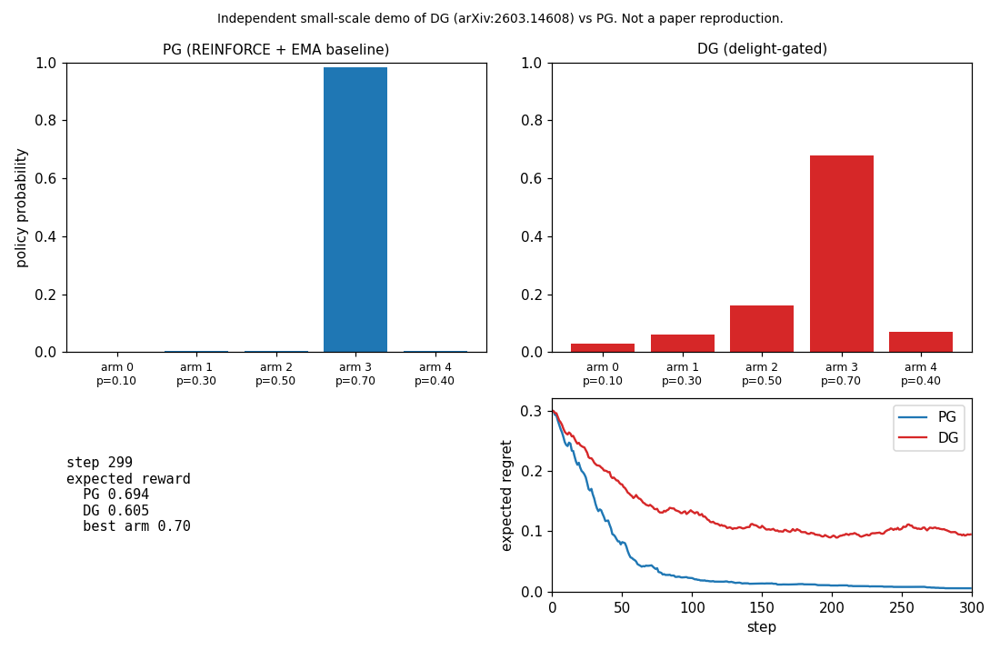
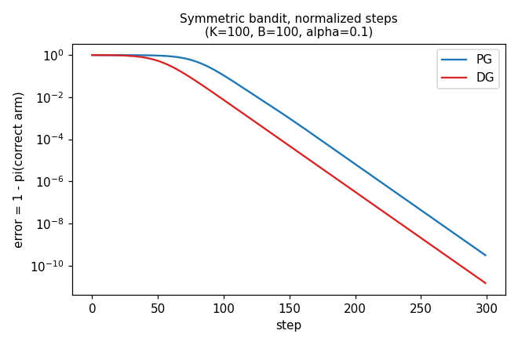
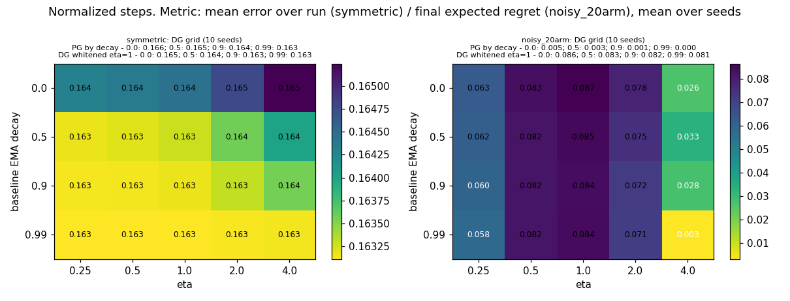
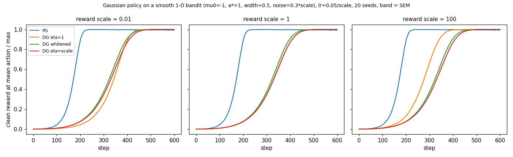
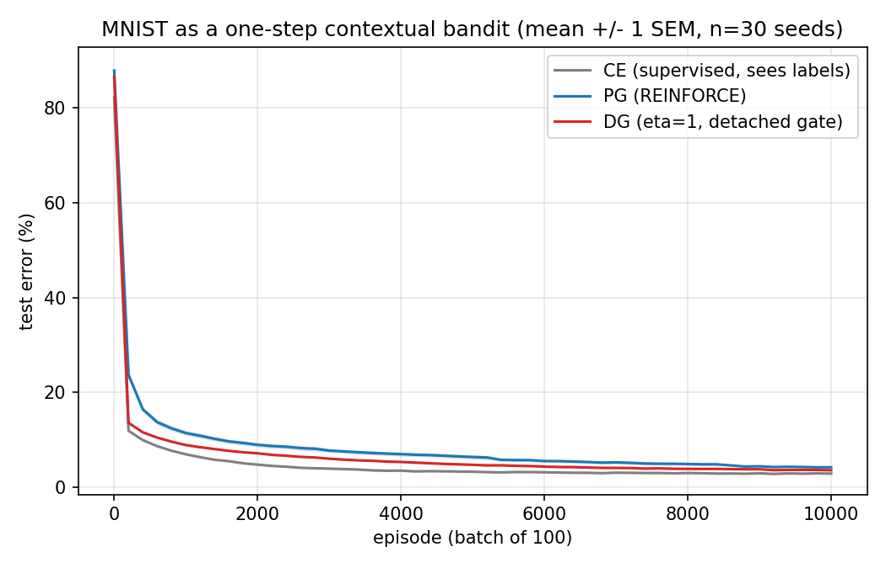
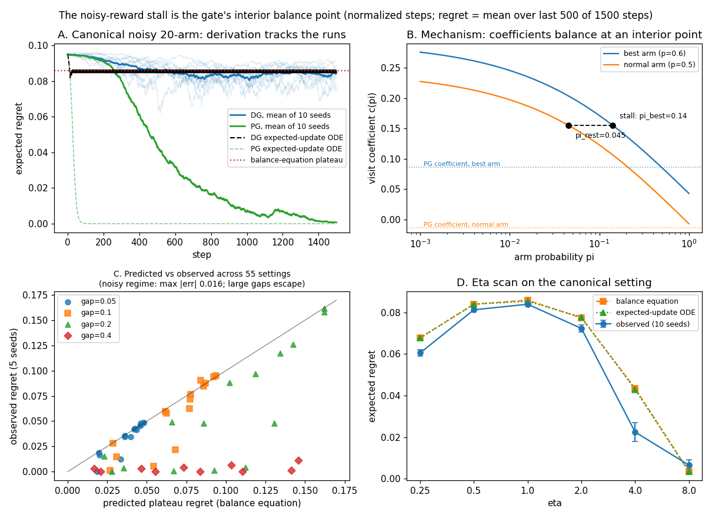
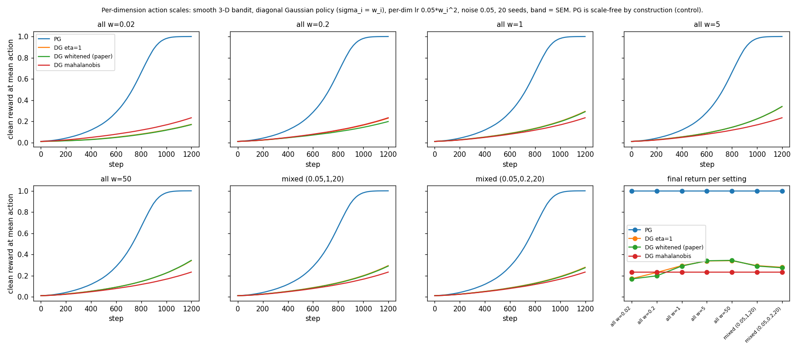

# Delightful Policy Gradient: a small bandit playground

A small playground (NumPy bandits, one PyTorch experiment) that compares plain policy gradient (REINFORCE) with the **Delightful Policy Gradient (DG)** from:

> Ian Osband (Google DeepMind), *Delightful Policy Gradient*, arXiv:2603.14608 (March 2026), accepted at the Reinforcement Learning Journal / RLC 2026.
> https://arxiv.org/abs/2603.14608

This is an independent, small-scale implementation written from the paper's Algorithm 1. **It is not a reproduction of the paper's experiments** and is not affiliated with the author or Google. The paper's larger setups (transformer sequence tasks, 28 DeepMind Control Suite environments at 10M steps) are not run here. Its MNIST diagnostic (Section 3) is run at the paper's configuration, with 30 seeds instead of 100 (result 7 below).

## The method in one paragraph

For each sampled action `A` with advantage `U` and policy probability `pi(A)`:

```
surprisal  l   = -log pi(A)
delight    chi = U * l
gate       w   = sigmoid(chi / eta)        (eta = 1)
update    += w * U * grad log pi(A)
```

A rare action with positive advantage (a "breakthrough") keeps almost its full weight; a rare action with negative advantage (a "blunder") is damped. Actions the policy already favors get a gate near 0.5. See `dgplay/bandit.py`.

## What is in the repo

| Path | What it does |
| --- | --- |
| `dgplay/bandit.py` | Softmax-policy K-armed bandit, PG and DG updates, optional unit-norm ("normalized") steps, optional delight whitening |
| `dgplay/analysis.py` | Exact expected-update analysis: per-visit gate coefficient, direction bias, expected direction, expected-update ODE, stall balance equation |
| `dgplay/contextual.py` | Synthetic 10-class contextual bandit with a linear softmax policy (reward = correct class) |
| `dgplay/continuous.py` | 1-D continuous-action bandit with a Gaussian policy (density-based surprisal, clipped log-density) |
| `dgplay/mnist.py` | MNIST as a one-step contextual bandit, two-layer ReLU MLP policy in PyTorch (the paper's Section 3 setup) |
| `scripts/make_demo.py` | Side-by-side animated demo (`docs/demo.gif`) |
| `scripts/compare.py` | Multi-seed PG vs DG over three bandit settings, optionally with normalized steps |
| `scripts/symmetric_normalized.py` | One-correct-arm bandit with normalized steps (my reading of the paper's symmetric-bandit setup) |
| `scripts/compare_contextual.py` | PG vs DG vs supervised cross-entropy on the synthetic contextual bandit |
| `scripts/sweep_eta_baseline.py` | Sweep of DG's temperature eta and the EMA baseline strength in two bandit settings |
| `scripts/stall_mechanism.py` | Tests whether the derived gate balance equation predicts the noisy-reward stall across 55+ settings |
| `scripts/compare_continuous.py` | PG vs DG with clipped, whitened, and retuned delight on the continuous bandit at three reward scales |
| `scripts/compare_continuous_multidim.py` | PG vs DG vs whitened DG vs Mahalanobis-surprisal DG on a 3-D bandit with per-dimension action scales |
| `scripts/compare_mnist.py` | PG vs DG vs supervised cross-entropy on MNIST; one (method, seed) per invocation, then `--plot` |
| `tests/` | Finite-difference gradient checks, gate formulas, expected-update analysis checks, and behavior tests |

## Run it

```bash
python -m venv .venv && source .venv/bin/activate
pip install -r requirements.txt
python -m pytest -q
PYTHONPATH=. python scripts/make_demo.py            # writes docs/demo.gif
PYTHONPATH=. python scripts/symmetric_normalized.py
PYTHONPATH=. python scripts/compare.py              # about 40 s on a CPU
PYTHONPATH=. python scripts/compare.py --normalize
PYTHONPATH=. python scripts/compare_contextual.py
PYTHONPATH=. python scripts/sweep_eta_baseline.py     # about 30 s on a CPU
PYTHONPATH=. python scripts/stall_mechanism.py          # about 2 min on a CPU
PYTHONPATH=. python scripts/compare_continuous.py     # about 20 s on a CPU
PYTHONPATH=. python scripts/compare_continuous_multidim.py  # about 1 min on a CPU
PYTHONPATH=. python scripts/compare_mnist.py --method dg --seed 0   # one run, about 10 s on a CPU
PYTHONPATH=. python scripts/compare_mnist.py --plot                 # aggregate + figure
```

Everything runs on CPU. The bandit experiments need only NumPy and Matplotlib; the MNIST experiment also needs PyTorch (the CPU wheel is fine). MNIST is downloaded once (about 10 MB) into `data/mnist/` on first use.

## Findings at a glance

- On the paper's MNIST diagnostic at its configuration, DG has lower mean error than PG at every checkpoint: 3.6% versus 4.2% final error over 30 seeds, ahead on 29 of 30 seeds, closing about 47% of the gap to supervised cross-entropy.
- In the tested normalized noisy-reward Bernoulli bandits, DG stalls below the optimum. A closed-form balance equation describes the gate's direction bias and predicts the stall and escape settings in the tested grid.
- In the tested diagonal-Gaussian bandits, per-dimension action scaling affects DG even with the paper's whitening. A mode-relative surprisal removes that scale dependence in these runs.

## Results from this prototype

All numbers come from `docs/results*.json`, produced by the scripts above. Seeds: 30 for the original bandit runs, 10 for the contextual task and the sweep, 20 for the continuous runs, 30 for the MNIST comparison (result 7) and 5 for the MNIST ablations (result 8). One configuration per setting, no tuning beyond the learning rates shown.

| Setting | PG | DG (eta=1) | Takeaway |
| --- | --- | --- | --- |
| Symmetric bandit, normalized steps | error < 0.1 at step 101 | step 74 | DG faster at equal step size (matches paper's direction) |
| Noisy Bernoulli bandits, un-normalized | faster in all 3 settings | slower | step-size effect: the gate (<= 1) shrinks DG's steps |
| Noisy 20-arm, normalized, eta=1 | final regret ~0.001 | stalls at ~0.084 | gate's direction bias; see sweep below |
| Synthetic contextual bandit | ~0.67 accuracy | ~0.67 (+0.002 to 0.007 over PG) | roughly tied, DG slightly ahead |
| Eta/baseline sweep (normalized) | solves both scenarios | symmetric: robust; noisy: stall unless eta >= 4 | stall is in the gate, not the baseline |
| Continuous 1-D bandit | identical at any reward scale | changes with reward scale; whitening fixes that | whitening makes eta unit-free, not faster |
| MNIST contextual bandit (MLP) | 4.2% final test error | 3.6% (supervised CE: 2.9%) | DG ahead at every checkpoint; closes about 47% of PG's gap to CE (30 seeds) |
| Noisy-reward stall mechanism (55 settings) | no interior fixed point, solves every setting | stalls at the gate's balance point | closed-form equation predicts the plateau in the noisy regime; large gaps escape |
| Continuous 3-D bandit, per-dimension action scales | identical at every scale (final 1.000) | final 0.171 (w=0.02) to 0.342 (w=50); whitening does not fix it | scale offset in the log-density inverts or saturates the gate; only the sum of log-scales matters |



**1. Symmetric bandit with normalized steps (K=100, one correct arm, B=100, alpha=0.1, fixed baseline 0.5).** DG gets to error below 0.1 at step 74 versus step 101 for PG (mean over 30 seeds). This matches the direction of the paper's claim that DG converges faster at equal step size. 

**2. Noisy Bernoulli bandits, un-normalized steps.** DG was slower than PG in all three settings and all learning rates I tried (`docs/compare.png`). Part of this is that the gate is near 0.5 for most samples, so DG takes smaller steps. That is a step-size effect, not evidence about direction.

**3. Noisy Bernoulli bandits, normalized steps (`docs/compare_normalized.png`).** On the 3-arm and sparse-reward 20-arm settings DG and PG were about equal (DG slightly slower on the 3-arm case). On a 20-arm setting with equal rewards of 0.5 and one arm at 0.6, DG stalled at an expected regret of about 0.08 while PG kept improving. A unit test (`tests/test_bandit.py::test_dg_has_upward_bias_on_rare_arm_with_noisy_equal_arms`) computes the exact expected update for one specific case: equal arms with Bernoulli(0.5) rewards, baseline 0.5, one rare arm. There PG's expected update is zero while DG's pushes probability toward the rare arm. That is a derivation for that case only; I have not shown it explains the stall in the 20-arm run or that it applies generally. The paper analyses deterministic-reward bandits and lists sparse-reward and other settings as open questions.

**4. Synthetic contextual bandit (`docs/contextual.png`).** PG, DG and supervised cross-entropy all end near the same accuracy (about 0.67 at the best learning rate). DG was slightly higher than PG at every learning rate (by 0.002 to 0.007, standard errors about 0.001 to 0.002), and cross-entropy degraded at high learning rates. This is not a replication of the paper's MNIST result.

**5. Sweep of eta and the baseline (`docs/sweep_eta_baseline.png`, 10 seeds, normalized steps).** The stall from result 3 is not a baseline or tuning problem: DG at eta=1 stalls at every baseline strength while PG solves the task at all of them, and the stall disappears exactly when the gate is flattened toward a constant (eta=4). Whitening the delight does not fix it either. Full detail: [docs/results-detail.md](docs/results-detail.md#5-eta-and-baseline-sweep).



**6. Whitening delight on a continuous-action bandit (`docs/continuous_whitening.png`, 20 seeds).** Unwhitened DG's behavior changes with the reward scale; whitened DG follows the identical curve at every scale, and retuning eta to the scale does the same. Whitening makes eta unit-free, as the paper says - it bought consistency, not speed (every DG variant is slower than PG here, the step-size effect of result 2). Full detail: [docs/results-detail.md](docs/results-detail.md#6-whitening-delight-1-d).



**7. MNIST as a one-step contextual bandit (`docs/mnist_curve.png`, 30 seeds).** This is the paper's own diagnostic (its Section 3), run at the paper's configuration: the learner sees an image, samples a digit from its policy, and gets reward 1 only if the sample is correct - the label is never revealed. Two-layer ReLU MLP (hidden width 100), Adam lr 1e-3, batches of 100, 10,000 episodes, constant baseline b = 0.5, eta = 1. The only deviations from the paper are 30 seeds instead of 100 and test error measured on a fixed 2,000-image subset of the test set. The gate is applied as the paper's Algorithm 1 specifies, as a fixed per-sample coefficient (`detach_gate=True` in `dgplay/mnist.py`; an "autograd through the gate" variant that also differentiates through the gate is kept as a labelled ablation via `--gate autograd` - paired difference over 11 matched seeds -0.01 pp, 95% CI [-0.25, +0.24], no detected difference on this task). Final test error: 3.58% (+- 0.06 SEM) for DG, 4.21% (+- 0.06) for PG, 2.88% (+- 0.04) for supervised cross-entropy, which sees the labels and is only a reference. DG was below PG's mean at every checkpoint, and below PG on 29 of 30 seeds at 10,000 episodes (paired difference PG minus DG 0.63 pp, 95% CI [0.48, 0.78]). DG closes about 47% of PG's gap to cross-entropy here (bootstrap 95% CI [37%, 56%] over seeds); the paper reports roughly half over 100 seeds. Unlike the bandit settings above, this is the experiment the paper itself runs, so the agreement in direction is more meaningful than the exact numbers.



**8. MNIST ablations from the paper's Appendix B (`docs/mnist_ablations.svg`, 5 seeds).** Same setup as result 7, varying one factor at a time around the paper's configuration (`scripts/ablations_mnist.py`, per-run and aggregated numbers in `docs/results_mnist_ablations.json`). These runs use the corrected detached gate (result 7); the pre-fix autograd variant gave materially different batch-mean and entropy rows (DG 5.2% with batch-mean, 3.5% with entropy 0.1), which is why this ablation was re-run.

| Ablation | PG | DG (eta=1) | Takeaway |
| --- | --- | --- | --- |
| Baseline b=0 vs 0.5 vs batch-mean | 5.9 / 4.1 / 5.5 | 4.1 / 3.6 / 3.6 | b=0 hurts both and PG most (a known high-variance case for REINFORCE without a baseline); for DG, constant minus batch-mean is -0.07 +- 0.14 pp paired (5 seeds) |
| 1 vs 4 vs 16 action samples per image | 4.1 / 3.8 / 3.6 | 3.6 / 3.3 / 3.4 | more samples help PG; DG at k=1 already matches PG at k=16 |
| Entropy regularization 0 vs 0.01 vs 0.1 | 4.1 / 4.0 / 3.8 | 3.6 / 3.5 / 2.7 | little effect at 0.01; 0.1 lowers PG slightly and lowers DG by 0.85 +- 0.22 pp paired (5 seeds) |

Final test errors in %, mean over 5 seeds (standard errors about 0.1, except 1.7 for PG with b=0). DG stays below PG in every configuration tried. All numbers are mean-of-5-seeds, not the paper's 100.

**9. The noisy-reward stall is the gate's interior balance point (`docs/stall_mechanism.png`, `scripts/stall_mechanism.py`; derivation in `dgplay/analysis.py`).** For Bernoulli bandits the gate's expected per-visit coefficient has a closed form, and the resulting balance equation predicts the stall level: across a 55-setting grid it matches within 0.016 in all 20 noisy-regime settings, and the prediction breaks exactly where DG escapes. Un-normalized controls restore the stall at the predicted level in every escape config, so the escape mechanism is measured, not assumed. Full detail: [docs/results-detail.md](docs/results-detail.md#9-stall-mechanism-closed-form).



**10. Per-dimension action scales: whitening does not fix what it fixed in 1-D (`docs/continuous_multidim.png`, `scripts/compare_continuous_multidim.py`, 20 seeds).** The paper motivates whitening with action scales that vary across dimensions; the 1-D testbed (result 6) could only vary reward scale. This testbed is a 3-D smooth bandit whose per-dimension widths set each dimension's action scale, with a diagonal Gaussian policy starting at each dimension's scale (sigma_i = w_i) and per-dimension learning rates lr * w_i^2. In z-units every scale choice is the same task, and PG is invariant to the widths by construction - a designed control, not natural optimizer robustness. Only the gate sees the scales. PG solves every setting (final return 1.000); DG at eta=1 does not: its final return runs from 0.171 (all widths 0.02) to 0.342 (all widths 50), monotone in the scale. Two failure modes, both from the scale-dependent offset in the Gaussian log-density: at small scales the surprisal is negative on average (measured mean -7.5 over the first 100 steps), so chi = U * l flips sign and the gate suppresses breakthroughs and amplifies blunders; at large scales the surprisal rails the +10 clip for 100% of the batch, so the gate degenerates to an advantage-magnitude filter with no surprisal signal left. A mixed setting with widths (0.05, 1, 20), whose log-scales sum to the same value as all-w=1, reproduces the all-w=1 run to floating-point precision (a unit test checks this), so what enters the gate is the sum of the per-dimension log-scales, not the heterogeneity itself.

The paper's batch whitening of chi does not restore invariance here. Paired per-seed differences in final return (whitened minus plain DG, 20 seeds): -0.002 +- 0.000 at w=0.02, -0.032 +- 0.000 at w=0.2, -0.004 +- 0.000 at w=1, +0.002 +- 0.001 at w=5, +0.003 +- 0.001 at w=50 - small against the 0.171-to-0.342 spread across scales, in both directions, largest at the intermediate width. The reason it cannot help here is visible in the formula: whitening cancels affine transforms chi -> a * chi + b with a > 0 (up to the eps in the denominator; a unit test checks this), and reward scaling is one - that is why it worked in result 6. An action-scale change instead adds a constant C to the surprisal, sending chi -> chi + C * U, which is not affine in chi: batch whitening recenters and rescales chi but leaves the advantage-dependent shift in place. That explains why invariance was not restored in this setting; it does not rule out that whitening helps with action scaling somewhere else. A mode-relative surprisal 0.5 * ||z||^2 (= log pi(mu) - log pi(a); my comparator, not the paper's variant) is scale-free by construction and gives identical runs at every scale (final 0.234) - but like whitening in result 6, it buys consistency, not performance: its level sits between DG's worst and best scale-dependent outcomes. Scope caveat: this is a toy diagonal-Gaussian gate; the offset is a coordinate convention of the differential log-density, and none of this speaks to the paper's DeepMind Control setup, where rewards were EMA-normalized and clipping was reported sufficient.



## Limitations

- The MNIST comparison uses 30 seeds and the MNIST ablations 5 seeds (the paper uses 100), and both evaluate on a 2,000-image test subset; everything else matches the paper's configuration. No continuous control.
- The normalized-step bandit follows my reading of the paper's Section 4, not its exact protocol.
- Small number of settings and seeds. Treat the comparisons as a study of behavior, not benchmarks.

## Possible extensions

- Done (result 8): the MNIST Appendix B ablations - other baselines, more action samples per image, entropy regularization.
- Done (result 9): the noisy-reward stall mechanism - closed-form per-visit gate bias, and a balance equation that predicts the stall level in the noisy regime (and where DG escapes it).
- Try whitening in a setting where action scales vary across dimensions, the case the paper motivates it with; the 1-D testbed here only varies reward scale.

## License

MIT. See `LICENSE`.
