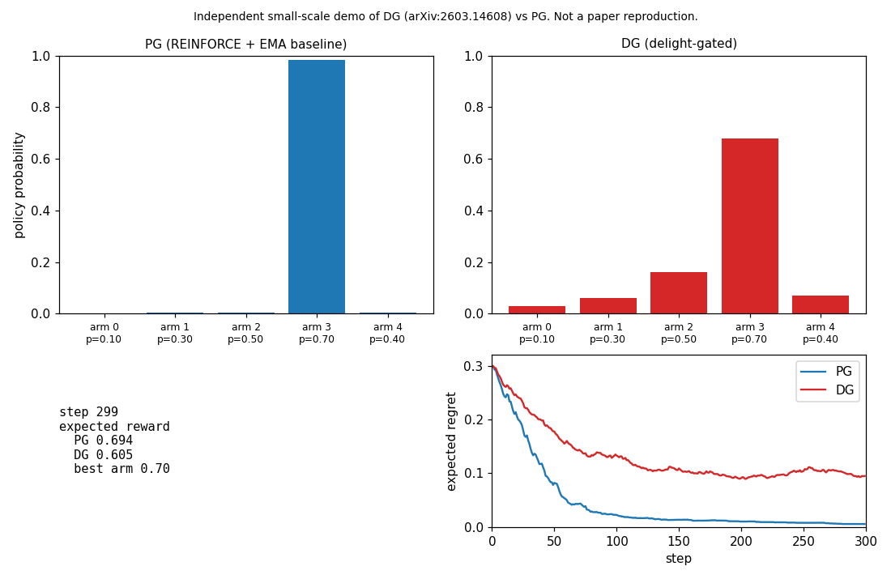
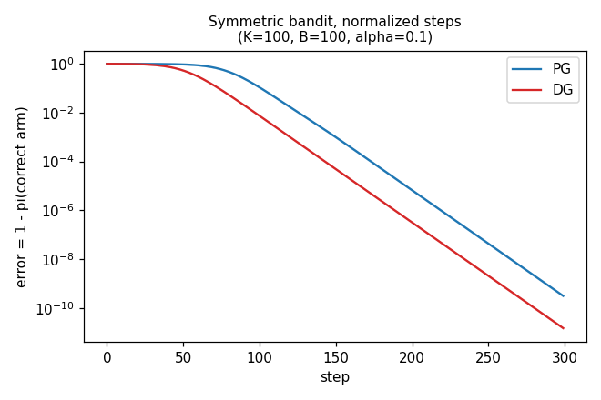
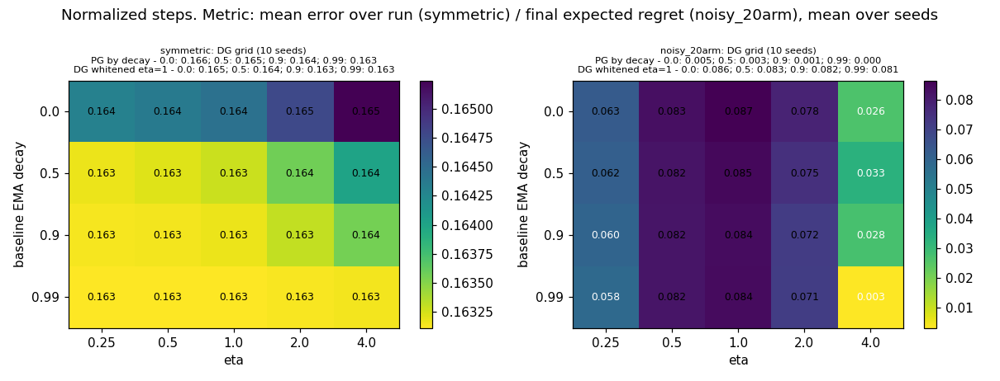
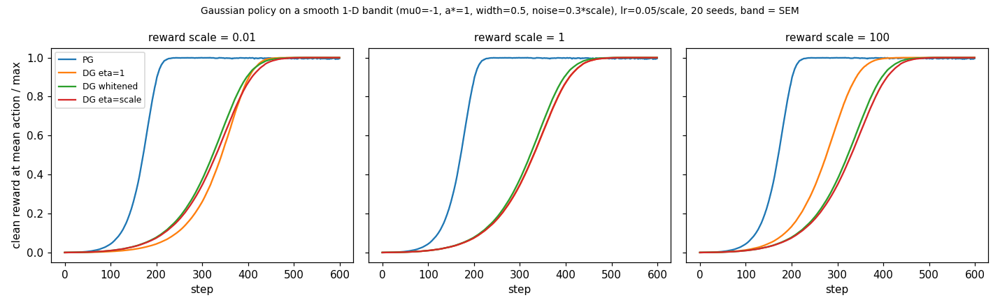
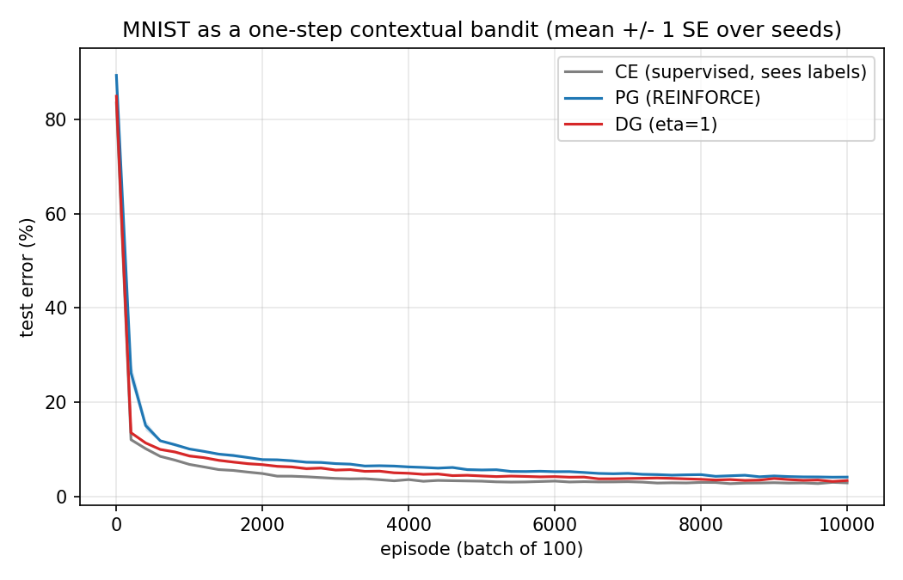

# Delightful Policy Gradient: a small bandit playground

A small playground (NumPy bandits, one PyTorch experiment) that compares plain policy gradient (REINFORCE) with the **Delightful Policy Gradient (DG)** from:

> Ian Osband (Google DeepMind), *Delightful Policy Gradient*, arXiv:2603.14608 (March 2026), accepted at the Reinforcement Learning Journal / RLC 2026.
> https://arxiv.org/abs/2603.14608

This is an independent, small-scale implementation written from the paper's Algorithm 1. **It is not a reproduction of the paper's experiments** and is not affiliated with the author or Google. The paper's larger setups (transformer sequence tasks, 28 DeepMind Control Suite environments at 10M steps) are not run here. Its MNIST diagnostic (Section 3) is run at the paper's configuration, with 5 seeds instead of 100 (result 7 below).

## The method in one paragraph

For each sampled action `A` with advantage `U` and policy probability `pi(A)`:

```
surprisal  l   = -log pi(A)
delight    chi = U * l
gate       w   = sigmoid(chi / eta)        (eta = 1)
update    += w * U * grad log pi(A)
```

A rare action with positive advantage (a "breakthrough") keeps almost its full weight; a rare action with negative advantage (a "blunder") is damped. Actions the policy already favors get a gate near 0.5. See `dgplay/bandit.py`.

## What is in the repo

| Path | What it does |
| --- | --- |
| `dgplay/bandit.py` | Softmax-policy K-armed bandit, PG and DG updates, optional unit-norm ("normalized") steps, optional delight whitening |
| `dgplay/contextual.py` | Synthetic 10-class contextual bandit with a linear softmax policy (reward = correct class) |
| `dgplay/continuous.py` | 1-D continuous-action bandit with a Gaussian policy (density-based surprisal, clipped log-density) |
| `dgplay/mnist.py` | MNIST as a one-step contextual bandit, two-layer ReLU MLP policy in PyTorch (the paper's Section 3 setup) |
| `scripts/make_demo.py` | Side-by-side animated demo (`docs/demo.gif`) |
| `scripts/compare.py` | Multi-seed PG vs DG over three bandit settings, optionally with normalized steps |
| `scripts/symmetric_normalized.py` | One-correct-arm bandit with normalized steps (my reading of the paper's symmetric-bandit setup) |
| `scripts/compare_contextual.py` | PG vs DG vs supervised cross-entropy on the synthetic contextual bandit |
| `scripts/sweep_eta_baseline.py` | Sweep of DG's temperature eta and the EMA baseline strength in two bandit settings |
| `scripts/compare_continuous.py` | PG vs DG with clipped, whitened, and retuned delight on the continuous bandit at three reward scales |
| `scripts/compare_mnist.py` | PG vs DG vs supervised cross-entropy on MNIST; one (method, seed) per invocation, then `--plot` |
| `tests/` | Finite-difference gradient checks, gate formulas, and behavior tests |

## Run it

```bash
python -m venv .venv && source .venv/bin/activate
pip install -r requirements.txt
python -m pytest -q
PYTHONPATH=. python scripts/make_demo.py            # writes docs/demo.gif
PYTHONPATH=. python scripts/symmetric_normalized.py
PYTHONPATH=. python scripts/compare.py              # about 40 s on a CPU
PYTHONPATH=. python scripts/compare.py --normalize
PYTHONPATH=. python scripts/compare_contextual.py
PYTHONPATH=. python scripts/sweep_eta_baseline.py     # about 30 s on a CPU
PYTHONPATH=. python scripts/compare_continuous.py     # about 20 s on a CPU
PYTHONPATH=. python scripts/compare_mnist.py --method dg --seed 0   # one run, about 10 s on a CPU
PYTHONPATH=. python scripts/compare_mnist.py --plot                 # aggregate + figure
```

Everything runs on CPU. The bandit experiments need only NumPy and Matplotlib; the MNIST experiment also needs PyTorch (the CPU wheel is fine). MNIST is downloaded once (about 10 MB) into `data/mnist/` on first use.

## Results from this prototype

All numbers come from `docs/results*.json`, produced by the scripts above. Seeds: 30 for the original bandit runs, 10 for the contextual task and the sweep, 20 for the continuous runs, 5 for MNIST. One configuration per setting, no tuning beyond the learning rates shown.

| Setting | PG | DG (eta=1) | Takeaway |
| --- | --- | --- | --- |
| Symmetric bandit, normalized steps | error < 0.1 at step 101 | step 74 | DG faster at equal step size (matches paper's direction) |
| Noisy Bernoulli bandits, un-normalized | faster in all 3 settings | slower | step-size effect: the gate (<= 1) shrinks DG's steps |
| Noisy 20-arm, normalized, eta=1 | final regret ~0.001 | stalls at ~0.084 | gate's direction bias; see sweep below |
| Synthetic contextual bandit | ~0.67 accuracy | ~0.67 (+0.002 to 0.007 over PG) | roughly tied, DG slightly ahead |
| Eta/baseline sweep (normalized) | solves both scenarios | symmetric: robust; noisy: stall unless eta >= 4 | stall is in the gate, not the baseline |
| Continuous 1-D bandit | identical at any reward scale | changes with reward scale; whitening fixes that | whitening makes eta unit-free, not faster |
| MNIST contextual bandit (MLP) | 4.1% final test error | 3.4% (supervised CE: 2.9%) | DG ahead at every checkpoint; closes about 60% of PG's gap to CE |



**1. Symmetric bandit with normalized steps (K=100, one correct arm, B=100, alpha=0.1, fixed baseline 0.5).** DG gets to error below 0.1 at step 74 versus step 101 for PG (mean over 30 seeds). This matches the direction of the paper's claim that DG converges faster at equal step size. 

**2. Noisy Bernoulli bandits, un-normalized steps.** DG was slower than PG in all three settings and all learning rates I tried (`docs/compare.png`). Part of this is that the gate is near 0.5 for most samples, so DG takes smaller steps. That is a step-size effect, not evidence about direction.

**3. Noisy Bernoulli bandits, normalized steps (`docs/compare_normalized.png`).** On the 3-arm and sparse-reward 20-arm settings DG and PG were about equal (DG slightly slower on the 3-arm case). On a 20-arm setting with equal rewards of 0.5 and one arm at 0.6, DG stalled at an expected regret of about 0.08 while PG kept improving. A unit test (`tests/test_bandit.py::test_dg_has_upward_bias_on_rare_arm_with_noisy_equal_arms`) computes the exact expected update for one specific case: equal arms with Bernoulli(0.5) rewards, baseline 0.5, one rare arm. There PG's expected update is zero while DG's pushes probability toward the rare arm. That is a derivation for that case only; I have not shown it explains the stall in the 20-arm run or that it applies generally. The paper analyses deterministic-reward bandits and lists sparse-reward and other settings as open questions.

**4. Synthetic contextual bandit (`docs/contextual.png`).** PG, DG and supervised cross-entropy all end near the same accuracy (about 0.67 at the best learning rate). DG was slightly higher than PG at every learning rate (by 0.002 to 0.007, standard errors about 0.001 to 0.002), and cross-entropy degraded at high learning rates. This is not a replication of the paper's MNIST result.

**5. Sweep of eta and the baseline (`docs/sweep_eta_baseline.png`, 10 seeds, normalized steps).** On the symmetric bandit, DG is insensitive to both: mean error over the run stays between 0.163 and 0.165 for eta in [0.25, 4] and EMA decay in {0, 0.5, 0.9, 0.99}, the same range as PG. On the noisy 20-arm setting the picture is different. The stall from result 3 is not a baseline problem: DG at eta=1 stalls at a final regret of about 0.082 to 0.087 at every baseline strength, while PG solves the task at all of them (final regret 0.000 to 0.005). Raising eta to 4, which flattens the gate toward a constant, removes the stall (final regret 0.003 at decay 0.99); lowering eta to 0.25 only softens it (about 0.06). In other words, the stall disappears exactly when the gate stops gating, which supports the direction-bias explanation from result 3 rather than a baseline or tuning issue. Whitening the delight (below) does not fix the stall either (whitened DG, eta=1: 0.081 to 0.086).



**6. Whitening delight on a continuous-action bandit (`docs/continuous_whitening.png`, 20 seeds).** The paper suggests whitening the batch of delights, chi_tilde = (chi - mean) / (std + eps), before gating, because density-based surprisal makes chi sensitive to scaling (its Algorithm 2 clips the log-density to [-10, 10]; both are implemented in `dgplay/continuous.py`). On a smooth 1-D bandit with a Gaussian policy, scaling the rewards by 0.01 or 100 changes how unwhitened DG at eta=1 behaves: at scale 0.01 the gate collapses to about 0.5 and DG becomes a half-magnitude PG (mean return over the run 0.448 versus 0.466 at scale 1); at scale 100 the gate saturates to a hard 0/1 filter, which happened to be faster here (0.552). Whitened DG follows the identical curve at every scale (0.478), and retuning eta to the reward scale also restores the scale-1 behavior (0.466). So whitening does what the paper says: it makes eta unit-free. Two honest caveats: PG is exactly scale-invariant here by construction (its update is linear in the advantage and the learning rate was divided by the scale), and in this task every DG variant is slower than PG (0.721), the same step-size effect as result 2 - this testbed uses un-normalized steps. Whitening bought consistency, not speed.



**7. MNIST as a one-step contextual bandit (`docs/mnist_curve.png`, 5 seeds).** This is the paper's own diagnostic (its Section 3), run at the paper's configuration: the learner sees an image, samples a digit from its policy, and gets reward 1 only if the sample is correct - the label is never revealed. Two-layer ReLU MLP (hidden width 100), Adam lr 1e-3, batches of 100, 10,000 episodes, constant baseline b = 0.5, eta = 1. The only deviation from the paper is 5 seeds instead of 100, and test error is measured on a fixed 2,000-image subset of the test set. Final test error: 3.4% (+- 0.1 SE) for DG, 4.1% (+- 0.1) for PG, 2.9% (+- 0.0) for supervised cross-entropy, which sees the labels and is only a reference. DG was below PG's mean at every checkpoint, and below PG on every individual seed at 10,000 episodes (2.9 to 3.8% versus 3.8 to 4.2%). DG closes about 60% of PG's gap to cross-entropy here; the paper reports roughly half over 100 seeds. Unlike the bandit settings above, this is the experiment the paper itself runs, so the agreement in direction is more meaningful than the exact numbers.



**8. MNIST ablations from the paper's Appendix B (`docs/mnist_ablations.svg`, 5 seeds).** Same setup as result 7, varying one factor at a time around the paper's configuration (`scripts/ablations_mnist.py`, per-run and aggregated numbers in `docs/results_mnist_ablations.json`).

| Ablation | PG | DG (eta=1) | Takeaway |
| --- | --- | --- | --- |
| Baseline b=0 vs 0.5 vs batch-mean | 5.8 / 4.1 / 5.4 | 4.1 / 3.4 / 5.2 | the paper's constant b=0.5 is best for both; b=0 hurts PG most (final errors 3.5 to 9.2% across seeds, a known high-variance case for REINFORCE without a baseline), DG degrades less |
| 1 vs 4 vs 16 action samples per image | 4.1 / 3.7 / 3.5 | 3.4 / 3.4 / 3.5 | more samples help PG; DG at k=1 already matches PG at k=16 |
| Entropy regularization 0 vs 0.01 vs 0.1 | 4.1 / 4.0 / 3.8 | 3.4 / 3.4 / 3.5 | little effect at 0.01; 0.1 helps PG slightly and does not help DG |

Final test errors in %, mean over 5 seeds (standard errors about 0.1, except 1.7 for PG with b=0). DG stays below PG in every configuration tried. All numbers are mean-of-5-seeds like result 7, not the paper's 100.


## Limitations

- The MNIST run uses 5 seeds (the paper uses 100) and evaluates on a 2,000-image test subset; everything else matches the paper's configuration. No continuous control.
- The normalized-step bandit follows my reading of the paper's Section 4, not its exact protocol.
- Small number of settings and seeds. Treat the comparisons as a study of behavior, not benchmarks.

## Possible extensions

- Done (result 8): the MNIST Appendix B ablations - other baselines, more action samples per image, entropy regularization.
- Investigate the noisy-reward stall mechanism further: the sweep (result 5) points at the gate's direction bias, but a general characterization is missing.
- Try whitening in a setting where action scales vary across dimensions, the case the paper motivates it with; the 1-D testbed here only varies reward scale.

## License

MIT. See `LICENSE`.
