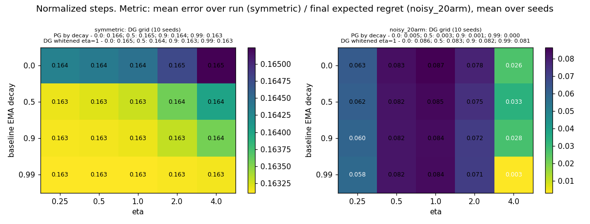
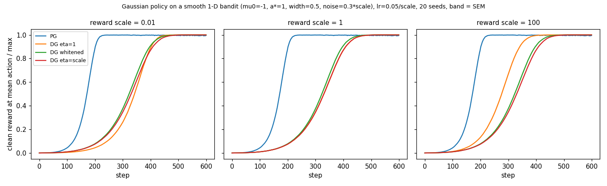
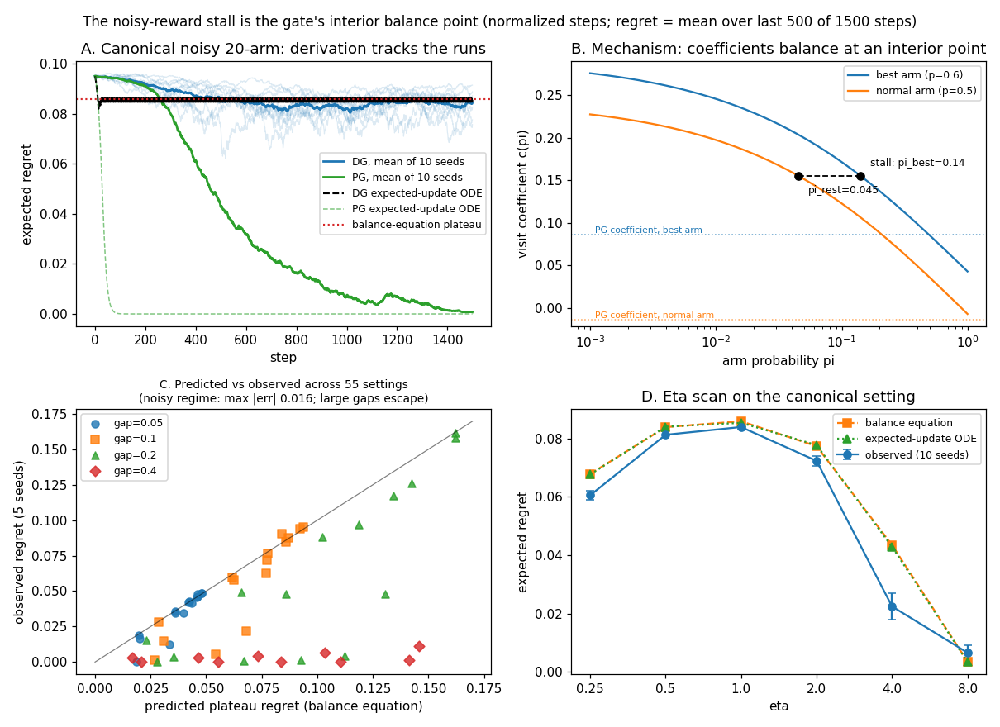

# Detailed results

Long-form write-ups moved out of the README to keep it skimmable. The README's
results table and one-paragraph summaries stay the overview; the numbers below are
the same ones in `docs/results*.json`.

## 5. Eta and baseline sweep

On the symmetric bandit, DG is insensitive to both: mean error over the run stays between 0.163 and 0.165 for eta in [0.25, 4] and EMA decay in {0, 0.5, 0.9, 0.99}, the same range as PG. On the noisy 20-arm setting the picture is different. The stall from result 3 is not a baseline problem: DG at eta=1 stalls at a final regret of about 0.082 to 0.087 at every baseline strength, while PG solves the task at all of them (final regret 0.000 to 0.005). Raising eta to 4, which flattens the gate toward a constant, removes the stall (final regret 0.003 at decay 0.99); lowering eta to 0.25 only softens it (about 0.06). In other words, the stall disappears exactly when the gate stops gating, which supports the direction-bias explanation from result 3 rather than a baseline or tuning issue. Whitening the delight (below) does not fix the stall either (whitened DG, eta=1: 0.081 to 0.086).

## 6. Whitening delight (1-D)

The paper suggests whitening the batch of delights, chi_tilde = (chi - mean) / (std + eps), before gating, because density-based surprisal makes chi sensitive to scaling (its Algorithm 2 clips the log-density to [-10, 10]; both are implemented in `dgplay/continuous.py`). On a smooth 1-D bandit with a Gaussian policy, scaling the rewards by 0.01 or 100 changes how unwhitened DG at eta=1 behaves: at scale 0.01 the gate collapses to about 0.5 and DG becomes a half-magnitude PG (mean return over the run 0.448 versus 0.466 at scale 1); at scale 100 the gate saturates to a hard 0/1 filter, which happened to be faster here (0.552). Whitened DG follows the identical curve at every scale (0.478), and retuning eta to the reward scale also restores the scale-1 behavior (0.466). So whitening does what the paper says: it makes eta unit-free. Two honest caveats: PG is exactly scale-invariant here by construction (its update is linear in the advantage and the learning rate was divided by the scale), and in this task every DG variant is slower than PG (0.721), the same step-size effect as result 2 - this testbed uses un-normalized steps. Whitening bought consistency, not speed.

## 9. Stall mechanism closed form

Result 5 left the mechanism open; for Bernoulli bandits it now has a closed form. Averaging the gate over the reward draw gives DG's expected per-visit coefficient on arm a: c(pi_a; p_a) = p_a(1-b)sigmoid((1-b)l_a/eta) - (1-p_a)b sigmoid(-b l_a/eta), with l_a = -log pi_a, and the expected direction is pi_a(c_a - sum_j pi_j c_j) (checked against exact enumeration and Monte Carlo in `tests/test_analysis.py`). PG is the same formula with the gate removed, c_a = p_a - b. DG's extra term is the direction bias of result 3, and at a matched baseline (b = p) it is p(1-p)[sigmoid(p l/eta) + sigmoid((1-p)l/eta) - 1] >= 0, larger for rarer arms - the general form of the old one-case unit test. Because c decreases as pi grows, an arm's probability rises only while its coefficient exceeds the probability-weighted mean, so the dynamics has an interior fixed point where all coefficients are equal. PG's coefficients do not depend on pi, so nothing balances below the optimum for it.

Solving the two-group balance condition c(pi_best; p_best) = c(pi_rest; p_rest), with the baseline at its fixed-point value b = p_rest + gap*pi_best, predicts the canonical stall at regret 0.086 - observed 0.084 (+- 0.001 over 10 seeds), and the deterministic expected-update ODE built from the same equations lands at 0.085 and tracks the stochastic trajectories the whole way (panel A). Across a 55-setting grid (K in {2,5,10,20,50}, gap in {0.05,0.1,0.2,0.4}, p_rest in {0.3,0.5,0.7}, 5 seeds each) the predicted plateau matches the observed one within 0.016 (mean 0.002) in all 20 noisy-regime settings (gap <= 0.1, p_rest >= 0.5), and stays close at gap = 0.2 for p_rest >= 0.5 (panel C). The prediction breaks exactly where the setting stops being noisy: at gap = 0.4 everywhere, and at p_rest = 0.3 from gap = 0.1 up, DG escapes - observed regret near zero where the equation predicts a deep stall (13 such configs, listed in `docs/results_stall_mechanism.json`). The escape mechanism is measured, not assumed: the one approximation in the ODE is E[d]/||E[d]|| instead of E[d/||d||], and switching normalization off in all 13 escape configs (un-normalized steps, lr 0.5, 20,000 steps, 5 seeds; the batch update then averages to the exact expected direction) restores the stall at the predicted level in every one - worst case 0.137 observed vs 0.141 predicted (K=50, p_rest=0.3, gap=0.4); see `unnormalized_escape_controls` in the results JSON. So in this grid every observed stall sat at the balance point (none was missed), and in every large-gap setting tried DG escaped instead of stalling; how far that pattern extends beyond Bernoulli two-group settings is open. The stall is also robust to structure: with 2, 5 or 10 good arms out of 20 it persists at a smaller, still-predicted plateau (predicted 0.074 / 0.048 / 0.023, observed 0.070 / 0.044 / 0.024). The same equation reproduces the eta scan of result 5 (predicted 0.068 / 0.084 / 0.086 / 0.077 / 0.043 / 0.003 for eta = 0.25..8, observed 0.061 / 0.081 / 0.084 / 0.072 / 0.022 / 0.007; the eta = 4 gap is the same escape effect at a flattened gate). Long-run controls at 4x steps separate stalls from slow convergence: at K=50, gap = 0.1 the DG stall persists (0.090) while PG, still catching up at 1500 steps, reaches 0.000. One caveat: the balance equation says where DG stops, not how fast it gets there.

